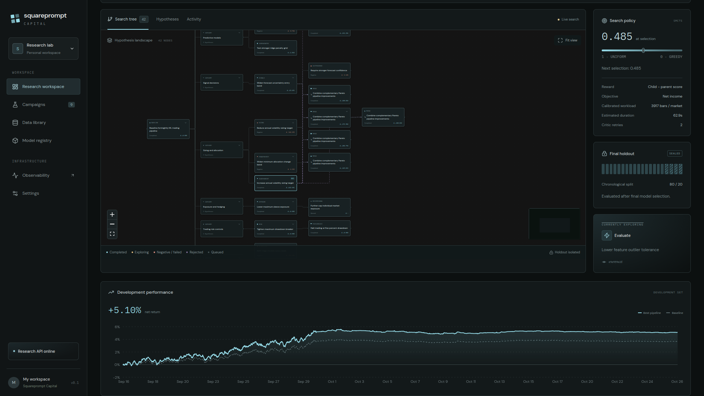

# Squareprompt Capital

A Docker-hosted research lab for discovering cryptocurrency and tokenized-asset trading pipelines on Hyperliquid. It combines an annealed stochastic Monte Carlo tree search, versioned Jupyter notebooks, developer/critic/researcher agents, and durable Temporal workflows with a React + shadcn/ui interface.

This release runs research campaigns and scheduled research refreshes. **It does not submit live orders.** The baseline is a volatility-scaled ridge model with cost-aware signals, risk-based sizing and retraining every 14 elapsed market days. Campaigns can use either synthetic data or Hyperliquid data. Both data sources use LLM agents.



## Start

Only Docker Engine/Desktop and Compose v2.20+ are required. No host Python, Node, Jupyter, Temporal, or database setup is needed.

```bash
docker compose up --build -d
```

Open [the research workspace](http://localhost:3000). To run LLM agents, open **Settings**, enter the OpenAI-compatible provider base URL and API key, then **Save & discover models**. Choose a model for each role in the campaign wizard. The initializer uses the Researcher model unless you select a separate one. Provider calls start after baseline evaluation and appear in the Opik **squareprompt-capital** project. Choose exact exchange market IDs in the campaign wizard. Fees, current funding, spread, historical candles and historical funding provenance are fetched automatically. Review the execution-cost snapshot before launch; its fee, hourly funding rate and spread stay fixed for the entire campaign. No signing key is used or required.

The local service ports deliberately avoid common existing research installations:

| Service | URL |
| --- | --- |
| Workspace | http://localhost:3000 |
| API and OpenAPI | http://localhost:8100/docs |
| Temporal UI | http://localhost:8082 |
| MLflow | http://localhost:5000 |
| TensorBoard | http://localhost:6007 |
| Opik (optional Docker profile) | http://localhost:5174 |

Start the bundled self-hosted Opik stack when you need LLM traces:

```bash
docker compose --profile opik up -d opik-ui
```

The isolated Opik profile uses Opik 1.11.14 with persistent MySQL, ClickHouse, Redis, ZooKeeper, and MinIO volumes and Docker memory limits. Its frontend is at [localhost:5174](http://localhost:5174), and the app's Observability page checks it before offering the link. Live agent inputs and outputs appear in the `squareprompt-capital` Opik project. If Opik is offline, the local call ledger and durable outbox retain them for retry. Allow about 2 GiB for the optional services; their host UI port binds to loopback.

### Interrupted campaigns

Power loss or a worker restart preserves Temporal history, research state, dataset snapshots, and notebooks. New Temporal histories contain the campaign settings, named stage inputs and results, checkpoint progress, notebook commits, and final winner and holdout metrics. Raw agent messages stay in Opik and the local ledger. Run `docker compose up -d` again. Transient network/provider failures retry with exponential backoff. Permanent configuration errors surface as **Needs attention**; fix the issue and press **Resume**. **Pause** takes effect at a durable step boundary, after in-flight work finishes. **Finish search** freezes the best evaluated notebook and runs the reserved holdout. It does not destroy history.

To stop containers while retaining research, use `docker compose stop` or `docker compose down`. Removing Docker volumes deletes research state. Back up the named research and Temporal volumes together with `notebook-history/` for consistent recovery.

## Campaign configuration

The interface uses a blue spruce palette. The wizard is ordered **Research brief → Markets & agents → Compute & data → Review & launch**.

- Select listed Hyperliquid markets by search or exact ID, including HIP-3 and spot IDs. Both sandbox and live modes fetch the exchange catalog when the wizard opens; no market options or initial selections are hardcoded.
- Select Pool initialization, Developer, Researcher and Critic models and reasoning efforts separately. The initializer falls back to the Researcher when left unset. Every reasoning input has a visible Suggestions menu and accepts typed values. Configure the provider in Settings, then fetch its model catalog in the wizard. Role choices can be remembered as defaults.
- **0 means unlimited** for USD, tokens, total evaluation seconds, experiment count, critic retries and refresh-run count. A zero target duration uses all available development data. Docker CPU/RAM containment and trading risk constraints remain in force. With every search ceiling disabled, finish or pause manually; annealing uses only enabled ceilings.
- Set target evaluation time before evaluation data. History (bars) is a requested candle count per market. The time-based suggestion uses a prior baseline pilot when available and adjusts for the chosen holdout and embargo. Use 4,900 bars to request the app maximum while keeping the time target; set target time to zero to score all selected development history. The wizard shows how the requested bars are split. Each new campaign still measures its own baseline, and manual history stays as set.
- Review latest fetched taker fees, hourly funding, bid/ask and full spread. Launch pins that exact snapshot across all nodes and the final holdout. Refresh schedules fetch new snapshots per campaign.
- A finite USD budget requires verified pricing for each chosen role model. With USD set to 0, models without pricing can run; unknown dollar costs are displayed as unknown while tokens are still tracked.

## What is implemented

- Twelve exact category branches immediately below the baseline, with per-category notebook edit scopes.
- Annealed search mixes uniform frontier sampling with reward-guided tree descent. Exploration is `max(0, 1 − max(USD fraction, token fraction, evaluation-time fraction, experiment fraction))`: 1 is uniform across queued hypotheses; 0 is greedy by mean reward. In-flight compute reservations do not count as elapsed evaluation time. The workspace displays the value recorded for the active decision.
- Each reward is **child objective − its evaluated hypothesis parent's objective**; reward and visits backpropagate along hypothesis ancestry. Gains remain signed.
- Objectives: annualized Sharpe, net income after fees/funding/slippage, or return minus twice maximum drawdown. The Pareto set maximizes return and Sharpe while minimizing drawdown.
- A developer → deterministic checks → critic → evaluation → researcher loop. Critic feedback drives configurable repair attempts. Developer and researcher have bounded public internet search/reference tools; source downloads use a managed point-in-time JSON gateway.
- On a new best score, evaluated semantic-merge nodes are queued for the other current Pareto members. LLM campaigns use the same developer, critic and evaluation loop for merges. Initial LLM hypotheses can inherit the latest champion. Researcher follow-ups choose a child, a sibling, or no proposal. A child starts from the evaluated node; a sibling starts from its comparison parent. Those inputs stay pinned, and additional improvements enter through explicit merge experiments.
- A real Jupyter kernel executes every candidate before chronological replay. Each function receives completed historical prefixes only. All external observations are filtered by `available_at`. The runner has no dataset volume, provider credentials, Docker socket, or external network route.
- Immutable chronological final holdout, an embargo, winner selection persisted before holdout access, and idempotent holdout results. Holdout metrics never enter selection, reward, hypothesis generation, or the Pareto set.
- A short baseline replay measures fixed startup overhead and per-bar compute cost. The application sizes a shared scoring window to the requested target duration. That target is not a cutoff: slower models can finish, and their runtime updates scheduling estimates. Only the remaining total campaign compute allocation imposes a hard deadline.
- Hard admission limits for LLM USD, tokens, evaluation wall time, experiments, critic retries, and final-holdout reservation. Ambiguous provider failures retain their maximum reservation; retries reserve again because a provider may have billed an unacknowledged call. Known usage settles a reservation down to actual cost.
- An outer Git repository for the application and a separate ignored inner Git repository at `notebook-history/.git`. Every draft, rejection, execution failure, and evaluated notebook is retained. Each evaluated experiment has a `campaigns/<campaign>/<node>` branch that forks at its input notebook commit. Attempts stay on the same branch; semantic merges link two actual parents. Each new commit contains the stable `notebook.ipynb` path for ordinary Git diffs. Git is written with Dulwich; host Git is not needed at runtime.
- TensorBoard metrics and state transitions per node; MLflow runs, artifacts, model versions, and a `research-winner` alias; Opik traces plus a local searchable call ledger and durable telemetry delivery.
- Finite Temporal-based interval refresh schedules with explicit total cost envelopes, pause/resume/stop, new datasets per interval, and new versions in the same research registry. No automatically enabled spending schedule.
- Interactive tree pan/zoom, fit, minimap, collapse/expand, status/reward labels, node inspection and notebook download; campaign history; data cache; artifact registry; provider discovery and budgets.

See the [verification record](docs/verification.md) for executed checks and remaining integration limits.

## Important implementation boundaries

This is a research application, not a production execution system. See [architecture and research assumptions](docs/architecture.md) for the precise evaluation contract and limitations.

- Hyperliquid's market catalog is discovered at runtime. ETC is never silently changed to ETH. Wrapped spot assets and HIP-3 names remain explicit, such as `@107` and `xyz:TSLA`. An unavailable ticker cannot be evaluated.
- Spot supports long/flat. Shorting uses perps. The current evaluator caps gross exposure at 1× and uses independent equal-capital market sleeves. Cross-asset historical prefixes are available to notebook stages, but a joint portfolio optimizer, margin engine, liquidation simulator, and live broker are not implemented.
- USDC-denominated spot and USDC-collateral perpetuals are supported. Non-USDC quote/collateral markets are blocked until quote conversion and aligned-asset fee semantics can be verified. HIP-3 fees use discovered deployer scale and growth mode; unknown metadata blocks evaluation.
- Candles are limited to the exchange's recent snapshot history (up to 4,900 requested bars here). There is no built-in paid historical archive or historical order-book reconstruction. Current fee tiers and the observed current half-spread are held constant across a replay, with the reviewed hourly funding rate held constant. Historical funding is retained as dataset provenance; old campaigns without a snapshot retain their historical-funding convention. They are labeled execution assumptions, not historical facts.
- The OpenAI-compatible `/models` standard does not require prices or reasoning levels. Advertised metadata is retained. If reasoning levels are missing, the editable field suggests none, minimal, low, medium, high, xhigh and max without claiming provider support. Custom effort strings are passed through unchanged; a blank field uses the provider default. Missing prices require explicit verified pricing before a USD-budgeted campaign can start. The application never invents supported reasoning levels.
- Notebook imports are deliberately restricted to numerical libraries. Additional sources must be public HTTPS JSON arrays with numeric `time`, `available_at`, and `value` fields (Unix milliseconds). CSV archives, arbitrary Python packages, authenticated data vendors, and arbitrary notebook formats need additional adapters.
- Source publication timestamps are declared by their upstream provider. The application validates and enforces them; it cannot prove historical availability independently. AST checks and an LLM critic are useful checks, not a mathematical proof of no leakage or a security boundary for hostile multi-tenant Python.
- End-to-end live agent quality and provider billing semantics require your provider credentials. Synthetic tests cannot validate trading profitability. Repeated development-set search introduces selection bias; the final holdout is an estimate, not a guarantee.

## Development and verification in Docker

```bash
docker compose run --rm --no-deps api python -m pytest -q
# Run a synthetic-data campaign with your saved role models and verify its final holdout:
docker compose exec -T api python < scripts/smoke.py
# Frontend checks run as part of its Docker build:
docker compose build web
```

The smoke test makes provider calls. It uses a $10 ceiling by default and accepts an explicit override through `SMOKE_LLM_BUDGET_USD`.

A baseline can be imported in the campaign wizard if it retains the stable contract and twelve category cell IDs. The bundled example is [`notebooks/baseline.ipynb`](notebooks/baseline.ipynb). Configure provider keys in the UI; do not commit secrets. `.env` is ignored. An optional `BRAVE_SEARCH_API_KEY` selects Brave search; public RSS search is the key-free fallback.

On hosts with broken Docker DNS, set `CONTAINER_DNS` in `.env` to a working DNS server. Build-network overrides are optional; default builds use standard Docker networking. A Linux host-network build can be run explicitly:

```bash
docker buildx build --allow network.host --network host \
  -t squareprompt-capital-python:local -f backend/Dockerfile --load .
docker buildx build --allow network.host --network host \
  -t squareprompt-capital-web:local -f frontend/Dockerfile --load frontend
docker compose up -d --no-build
```

`PIP_INDEX_URL` is an optional backend build argument for an approved package mirror. All application processes, builds, notebook kernels, tests, and observability services run in Docker.


### Bundled ML baseline

`baseline.ipynb` fits a separate model for each market. It predicts next-open to fourth-close returns in units of volatility known at the time of the decision. Twelve features describe momentum, trend efficiency, volatility, candle shape, volume and opening gaps. The first fit uses at least 32 matured targets and shrinks forecasts toward zero. With at least 96 targets, two chronological validation folds select the ridge penalty and estimate how much to shrink the forecast and how uncertain it is. The folds exclude training targets that overlap validation.

The notebook refits every 14 elapsed days when additional training data is available. It uses up to 2,048 examples from the most recent 90 days or 256 bars, whichever covers more time, with more weight on recent examples. Separate entry and exit bands account for pinned round-trip costs, adverse funding and forecast uncertainty.

Sizing starts from a 15% annualized volatility target and caps each sleeve using typical candle notional, trade counts and recent adverse funding. If trade counts are unavailable, sizing uses candle volume to measure activity. The exposure stage estimates each sleeve's beta and correlation to the other selected markets from aligned, completed candles. It lowers the sleeve's cap when the shared market trend moves against the position. Historical funding informs sizing, while replay fills use the campaign's frozen funding rate.

The risk stage caps exposure against the larger of a three-sigma price move and the biggest recent move. It pauses after unusually large returns and latches a 2.5% sleeve loss until the next UTC day. It tapers exposure from a 3% drawdown and halts the sleeve at 15%.

Final holdout predictions may use completed observations for indicators, but **fitting, scaling and parameter selection use only pre-embargo history**. The final model is initialized from this longer training prefix rather than a 64-bar warmup. Full holdout length and prior winner selection remain unchanged. Short calibration/search windows may contain no scheduled refit; they still run the initial fit, and longer windows exercise the same two-week update rule.

Each fit's coefficients, scaler, penalty, forecast calibration, sample count and timestamps are retained in the evaluated notebook and MLflow `models.json`. TensorBoard records fit events. The notebook's retraining cell controls the fit cadence. A research refresh starts a separate campaign only when you explicitly create a schedule and enter its interval.


### Development benchmarks

The Development performance chart compares the best pipeline and baseline with Buy & hold. The benchmark appears when calibration fixes the scored development window, and uses equal capital per market and the campaign's exposure cap at entry. It holds fixed quantities from the first scored open through the last scored close and includes entry/exit taker fees, half-spread and funding. The benchmark reads the frozen development snapshot, is cached per campaign, and never affects model selection.
