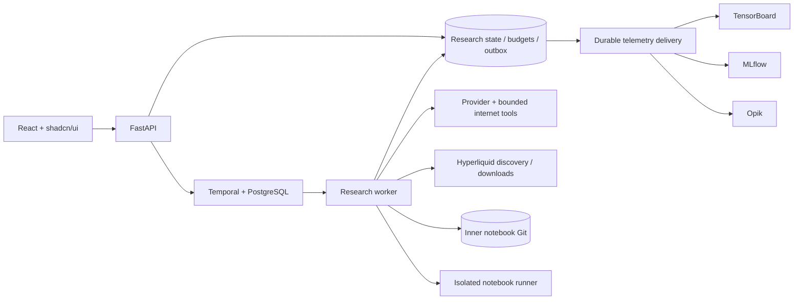

# Architecture and evaluation contract

## State machine and recovery

Each campaign uses one Temporal workflow. Its activities advance a persisted state machine:

`prepare → calibrate → baseline → seed → select → develop → critic → evaluate → research → select … → finalize → done`

A repaired candidate re-enters `develop`. A rejected or failed node returns to `select`. Semantic merge nodes pass through `develop`, `critic`, and `evaluate` using the same budgets; they do not recursively generate more merge nodes. New hypotheses are generated only from evaluated hypothesis nodes.

Activities contain all network, LLM, randomness, filesystem, and database work. Workflows contain only timers, signals, and activity/child-workflow orchestration. Activities heartbeat every five seconds, retry transient errors indefinitely with capped exponential backoff, and keep exact failed phases for explicit resume after permanent errors. Workflow history continues as new every 150 steps. A campaign UUID and step-specific LLM keys make completed calls reusable after replay.

New campaign workflows start with a compact configuration snapshot and a saved checkpoint. Named activities such as `campaign_calibrate`, `campaign_evaluate`, and `campaign_finalize` carry the relevant checkpoint and return the new stage, active node, score, metrics, and Git commit. A retry whose expected checkpoint already advanced returns the saved state without executing another stage. Completed workflows return the winner and final holdout metrics. Heartbeats identify the current phase, node, step and attempt. The legacy string-input workflow path remains replayable. New scheduled refreshes use the same structured child history. Payloads omit raw notebooks, data rows, prompts and provider credentials.

SQLite uses WAL, immediate transactions, a busy timeout, and a shared persistent Docker volume. The worker serializes campaign activities. The API's dispatch reconciler recovers a crash between creating a campaign/schedule record and starting its Temporal workflow. Temporal uses a separate persistent PostgreSQL volume. These are crash-recovery mechanisms, not a substitute for backups or protection against storage-device failure.

A notebook evaluation runs in its own subprocess and Jupyter kernel in the runner container. Exhaustion of the remaining campaign compute allocation kills the evaluator and its descendants, including Jupyter kernels that create a separate session. The runner uses a read-only root, ephemeral home/tmp, non-root UID, dropped capabilities, no-new-privileges, CPU/memory/PID limits, and an internal network. It has no research volume, holdout filesystem, provider keys, or Docker socket. The worker sends only the dataset window required for that evaluation.

## Search and inheritance

The root is the evaluated baseline. The twelve category nodes are structural children of the root. Their initial hypotheses evaluate against the baseline; later hypotheses evaluate against their actual evaluated hypothesis parent. Category nodes aggregate descendant visits/rewards but never receive fabricated scores.

A seeded RNG makes selections reproducible from campaign ID and persisted step. With probability epsilon, it samples uniformly over eligible queued hypotheses. Otherwise it descends the tree using local normalized mean rewards plus a visit bonus weighted by epsilon. At epsilon zero, only mean reward determines rank, with deterministic ties. The engine persists the exact value used for the decision; the UI continues to display it during development, review and evaluation. The next-decision estimate excludes compute reservations until elapsed runtime settles. Priority merge selections are identified separately.

When a new best objective value appears, the current Pareto set is recomputed on development metrics. Merge nodes compare the champion and each other Pareto member. Their outputs are reviewed and evaluated, and a successful merge is recorded with two Git parents. The sandbox's merge is explicitly a deterministic mechanics demonstration; it does not simulate LLM intelligence.

Initial live hypotheses can inherit the latest champion notebook at selection, with `inherited_from` tracking that implementation base separately from the comparison parent. Explicit research follow-ups choose `child`, `sibling`, or `none`. Children use the current evaluated notebook and score; siblings share its structural and evaluation parents, testing an alternative from that evaluated input. Follow-ups pin the notebook and sources for their chosen comparison; later champions enter through explicit merges. The researcher sees the comparison parent's category source and nearby attempts. Repeated proposals are discarded and comment-only/no-source patches are rejected before evaluation. Sandbox research has a finite list of untried edits and stops proposing along an exhausted line instead of adding tracking wrappers.

## Notebook contract

The notebook has one immutable Markdown contract cell and twelve code cells with IDs matching the categories. Each code cell defines `stage_<id>(history, state)`. The pipeline order is sources, quality, storage, retraining, state, models, signals, sizing, exposure, risk, drift, registry. A developer can replace only the authorized category's source. A semantic merge can replace all category sources, but never the contract.

`history` contains only completed OHLCV and funding records through the decision timestamp. Each stage returns a state dictionary. The context contains the current market ID, available source observations, cross-asset historical prefixes, prior position, sleeve equity, drawdown, forecast, and target exposure. Every replay decision receives fresh copies of input histories. A model can refit from historical prefixes; it cannot use future validation labels. Stateful model serialization, efficient rolling fit caches, and advanced feature-store plugins are extension points.

Imports are limited to NumPy, pandas, math, statistics, and collections. AST validation rejects scope changes, disallowed imports, I/O/introspection primitives, negative shifts, and centered rolling windows. Candidates execute in a real Jupyter kernel before trusted chronological replay. The exported evaluated notebook has metrics attached to its final cell's output.

## Evaluation and cost assumptions

A signal computed after bar `t` closes executes at bar `t+1`'s open. Prior positions receive gap P&L; the new position receives open-to-close P&L. Turnover pays taker fees and an observed half-spread assumption. New campaigns pay/receive the reviewed current hourly funding rate scaled by bar duration and signed position; that rate stays constant for every node and holdout. Historical funding remains in dataset provenance and in historical input prefixes. Legacy campaigns without an execution snapshot retain their original historical-funding cost convention. Final positions are liquidated for scoring with exit trading costs. Spot targets are clamped to nonnegative exposure; long-only and short-only rules are enforced by the trusted evaluator.

Each market gets an equal initial-capital sleeve. Exposure is capped at 1×. Total portfolio return and drawdown come from aggregate sleeve equity, not from adding market Sharpe ratios. Sharpe uses candle frequency and a 365-day annualization basis with zero risk-free rate. Sharpe is clipped at ±100 to avoid degenerate objective arithmetic. There is no leverage/margin/liquidation model, order-book queue, intrabar fill path, partial fill, min-notional/lot-size enforcement, borrow lending, corporate-action adjustment, or dynamic market-impact model. These omissions prevent treating a selected artifact as production ready.

Live fees are fetched from `userFees` using the configured master wallet or zero address for public base rates. For USDC-collateral HIP-3 markets, the discovered deployer fee scale `d` yields `(max(1,d)+d)` times the base fee, with a 0.1 multiplier for enabled growth mode. Unknown fee fields, non-USDC collateral, and non-USDC spot quotes block scoring instead of silently using a guessed fee. The fee metadata, current hourly funding and spread are frozen in the campaign snapshot, and their use across past bars is explicitly an assumption. Historical fee-tier changes and historical spreads are not reconstructed.

A calibration replay uses up to 120 development bars. It measures fixed kernel/startup overhead separately from the replay time. The shared workload is `64 + floor((target_seconds − startup_seconds) / seconds_per_portfolio_bar)`, bounded by available development data and a minimum of 20 scored bars. A portfolio bar includes every allowed market. If the requested target is shorter than startup plus minimum useful work, the app reports the larger estimate rather than killing the baseline. All candidates retain this frozen scoring window; changing it independently for each model would make rewards incomparable. The holdout stays full length and is never shortened to meet the target.

The target is an estimate, not an evaluation timeout. Notebook cells and replay have no target-based cutoff. Runtime estimates update from completed candidates, while the protocol remains fixed. Search stops admitting new experiments when estimated work plus the reserved final holdout will not fit the remaining campaign budget. A candidate may finish after the target. The runner's hard deadline is the remaining total campaign allocation minus its holdout reservation, which is separate from the target. Estimation can be inaccurate for nonlinear model costs or changing machine load; the campaign-wide budget remains authoritative.

## Holdout

Data is fetched once, sorted, validated for continuous closed bars, and pinned by SHA-256. The last configured fraction is the chronological holdout. An embargo separates development from holdout. The holdout does not enter the calibration payload, LLM prompts, developer notebook, critic inputs, search scores, or Pareto metrics.

Selection is persisted before the holdout request. Only the frozen winner receives the final window, including the full preceding causal history for indicator warmup and fitting. Its dataset carries an `evaluation_start` index at the holdout split and a `training_cutoff` before the embargo. The evaluator supplies a separate `training_history` ending at that cutoff; the ML baseline fits exclusively on it. Final replay includes all holdout bars after `evaluation_start`; already computed results are cached idempotently. A crash after computation but before persisting the result can require recomputing the same frozen notebook. This is at-least-once execution of an unchanged final evaluation, not a new model selection opportunity.

The application enforces declared `available_at` timestamps for additional source observations, but cannot independently prove an upstream timestamp's truth. Source revisions, benchmark survivorship, selection on the development period, and repeated campaigns can still bias an estimate. These are research questions, not issues an LLM critic can conclusively certify away.

## Budgets and side effects

Before every provider attempt, the app reserves a conservative input upper bound (UTF-8 serialized request bytes plus overhead), the maximum output tokens, and their advertised or verified dollar cost. It requests a bounded completion. Returned token usage settles the reservation. Ambiguous failures retain their full reservation and subsequent attempts reserve again. The `Idempotency-Key` header is sent, but a generic third-party provider may ignore it. It is impossible to guarantee exactly-once third-party billing across an ambiguous connection loss without provider support. Reservations are conservative local admission control, not control over a vendor's billing system.

Each evaluation temporarily reserves the remaining campaign allocation available to it, protecting the separately estimated final holdout reserve. Successful evaluations and received failures settle to measured elapsed time. An ambiguous runner/network failure retains its reservation conservatively; this may require a budget increase after an interruption. Neither target overruns nor partial evaluations produce fabricated scores. Budgets can be increased with `PATCH /api/campaigns/{id}/budgets` before resume. The historical API field `evaluation_seconds` now means target duration, not a per-node cap. Completed campaigns are not recalibrated or rewritten.

Telemetry uses a persistent outbox. TensorBoard state/metrics, MLflow runs/artifacts/versions, and Opik agent I/O retry independently of campaign progression. Tagged MLflow runs and model-version checks reduce duplicate artifacts after a delivery crash. Opik trace IDs derive deterministically from the durable ledger key, so retries use the same trace identity. HTTP delivery is independent of LLM provider calls. Opik delivery uses deterministic UUIDv7 IDs derived from each outbox record and original timestamp so retries reuse the same trace. The optional isolated Opik Compose stack exposes its UI on loopback port 5174. Its browser API proxy and trace list are verified separately from ingestion.

## Interval refreshes

A refresh schedule is enabled explicitly in the registry; a maximum-run count of zero means unlimited. Its total envelope is the per-campaign cap multiplied by maximum runs. Temporal stores each interval timer. Each completed refresh seeds the next from its winner, preserving notebook code but fetching fresh market data and reserving a fresh chronological holdout. Model versions use the originating research registry name. Pausing/stopping a schedule affects future runs; an active child campaign remains independently controllable in the workspace. No timer submits trades or automatically promotes a notebook into a live account.

## Upstream references

- [Hyperliquid Info endpoint and candle conventions](https://hyperliquid.gitbook.io/hyperliquid-docs/for-developers/api/info-endpoint)
- [Hyperliquid perpetual metadata and builder DEX discovery](https://hyperliquid.gitbook.io/hyperliquid-docs/for-developers/api/info-endpoint/perpetuals)
- [Hyperliquid fees and growth mode](https://hyperliquid.gitbook.io/hyperliquid-docs/trading/fees)
- [Temporal Python error handling and idempotence](https://docs.temporal.io/develop/python/best-practices/error-handling)
- [MLflow tracking server](https://www.mlflow.org/docs/latest/self-hosting/architecture/tracking-server/)
- [Opik Docker deployment](https://www.comet.com/docs/opik/self-host/local_deployment)

## Zero ceilings and role configuration

Campaign USD, token, evaluation-time, experiment and critic-retry ceilings treat zero as disabled. Search temperature ignores disabled ceilings; it stays at 1 if none is enabled. An unlimited evaluation budget sends no execution deadline to the runner and uses no HTTP read timeout. The historical `evaluation_seconds` field is a workload target: zero chooses all available development bars. Runtime container CPU/RAM limits and risk controls remain independent. A zero refresh-run cap keeps the schedule active until paused/stopped, with history continued as new periodically.

The `agents` configuration maps initializer, developer, researcher and critic to independent model/reasoning selections. The initializer only seeds the initial hypothesis pool; if unset it uses the Researcher selection. Legacy campaigns can still use the shared `model` fallback. Every provider call selects by its actual role, and the call ledger records that model. Unknown prices block finite USD budgets; with unlimited USD, tokens are counted and unknown monetary costs are labeled explicitly.

Execution snapshots are immutable cache records selected by ID. A snapshot is validated against market IDs, instrument, mode and fee-account address at launch and preparation. The worker stores it alongside immutable dataset snapshots; candidate edits never change costs. A new interval refresh clears the previous snapshot ID so it obtains current quotes. Default data suggestions use a previous measured pilot when available and are provisional until the campaign's own calibration.

## Editable reasoning and exchange catalog

Reasoning suggestions use provider-reported levels when available, otherwise `none`, `minimal`, `low`, `medium`, `high`, `xhigh`, and `max`. These are suggestions, not capability claims. All role inputs accept custom strings, preserved by campaign validation, saved defaults and provider requests. An empty field omits `reasoning_effort`; the literal `none` is sent explicitly. The provider determines support.

Both campaign modes request `/api/markets?refresh=true` when the wizard opens and on explicit refresh. Forced discovery bypasses the 30-minute catalog cache and fetches Hyperliquid perpetual dex metadata plus spot metadata. There is no preset fallback. Exact-ID additions must match the fetched catalog and instrument; campaign API requests require explicit markets. Dataset reuse is unchanged.

Resource ceilings precede evaluation data. The adaptive target is the final field in the same six-input resource grid, and changes still recalculate suggested data defaults while preserving manually edited data fields.

## ML baseline v2

The bundled notebook retains all twelve independently editable category cells. Model state belongs to the models cell and resets for each market/replay. The notebook retraining cell owns the policy settings (14 elapsed days, 90-day history, 2,048-example cap, 32-example minimum, four-bar prediction horizon). Research refresh schedules require an explicit interval independent of this policy. The models stage owns fit timing and estimator/scaler state, so replacing a models stage does not break retraining or registry cells.

Ten causal OHLCV features predict `close[j+4] / open[j+1] - 1`. Only examples with a completed endpoint enter fitting. Training standardization, clipping, and intercept-plus-ridge regression use numerical libraries already inside Docker. With at least 80 examples, chronological past-only validation selects alpha from 1, 10 and 100; a four-example purge separates its fitting and validation folds. All examples must still precede the evaluator's training cutoff. There is no future-looking shift or fitted preprocessing on final holdout.

The evaluator supplies candle duration, pinned execution costs and a fitting prefix to every stage. It adds numeric `model_fit_count` to evaluation metrics, embeds serialized fit artifacts in notebook outputs, and returns them for durable telemetry. MLflow stores `models.json` beside the notebook; TensorBoard stores sample counts, alpha and fit snapshots. Artifact history includes coefficients and scalers at every successful fit, not only the final fit. The final holdout provides a fixed pre-embargo training prefix, so held-out outcomes never retrain this baseline; completed holdout bars may update indicators. This fit contract remains subject to notebook review for arbitrary developer-written variants.

## Notebook Git branching

New runs write commit objects directly to the inner repository. Each `campaigns/<campaign>/<node>` branch starts from its actual input commit, including inherited champion notebooks, and later statuses advance only that branch. Successful merges retain their evaluated attempt as the first parent and link the complementary Pareto member as the second parent. Each commit uses `notebook.ipynb` at the repository root; immutable materialized copies under `.git/capital-artifacts` support artifact upload. Notebook reads and downloads resolve the recorded commit. Existing history and legacy paths remain readable without rewriting their hashes.

Use `git log --graph --oneline --decorate --branches='campaigns/<campaign>/*'` in the inner repository to inspect a campaign's ancestry. The node inspector displays the branch name for new commits.

## Passive development references

`GET /api/campaigns/<id>/benchmarks` lazily computes and caches a fixed-quantity Buy & hold equity series from the frozen development prefix. It uses the calibrated replay timestamps while the baseline is running and the recorded baseline timestamps for completed evaluations. It does not run a notebook or open holdout records for scoring. Each market starts with equal capital; positions are sized at the exposure cap after entry costs. Pinned taker fees and half-spread apply on entry/exit, and signed perpetual funding applies to the held opening notional each bar. Legacy snapshots without pinned funding use their original historical series. Benchmarks are chart-only and do not enter reward, Pareto selection or researcher evidence.

## Dashboard reads and history suggestions

Overview polling returns detailed curves for the selected campaign and compact cards for the rest. Projections are bounded and reused by campaign revision. The client waits for one poll to finish before starting another. History suggestions select only pilot timing and market count; replay bodies are not decoded by that endpoint. The wizard debounces edits, cancels stale reads, preserves manual history, and retries a transient server failure once. Requested history includes the development and holdout windows, the 64-bar warmup, and the embargo. The 4,900-bar request cap is separate from the target replay time.
